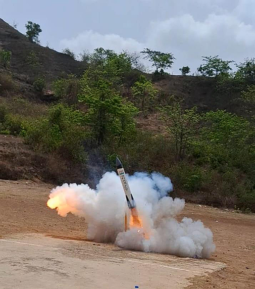

# Project GARUD: Thrust-Vector-Controlled Model Rocket

**Project Objective:**  
Design, simulation, fabrication, and integration of a thrust-vector-controlled (TVC) model rocket incorporating a dual-motor ascent-and-landing concept.

GARUD was a four-member multidisciplinary engineering project spanning mechanical design, flight simulation, control-system development, fabrication, and hardware integration. As team leader, I coordinated work across these areas while contributing to the design and development of key mechanical subsystems.

---

## Project Overview

GARUD explored the development of a rocket with thrust-vector control for directional control and a dedicated powered-landing concept. The proposed dual-motor configuration assigned separate propulsion systems to ascent and landing.

The project brought together mechanical design, flight-physics simulation, control-system development, and physical prototyping. Although the powered-landing objective was not achieved, the project provided practical experience in integrating multiple engineering subsystems and working through the challenges of translating a design concept into hardware.

The engineering workflow broadly followed:

**Concept → Simulation → Control → CAD Design → Fabrication → Integration**

---

## Design and Hardware

### 1. TVC Mount Design

The CAD model shows the thrust-vector-control (TVC) mount and its mechanical components, forming the basis of the rocket's thrust-vectoring assembly.

  

### 2. Deployable Landing-Leg Mechanism

The landing-leg assembly was designed to provide a compact configuration and deployable support for the rocket. The model shows the mechanism in its folded and deployed configurations.

  

### 3. Full Rocket CAD Assembly

The transparent CAD assembly provides an overview of the rocket's internal arrangement, including the electronics, TVC assembly, and landing-leg mechanism.

  

### 4. TVC Hardware and Servos

The assembled TVC mount with servos illustrates the transition from mechanical design to actuator integration and control-system development.

  

### 5. Physical Prototype

The assembled GARUD rocket demonstrates the physical integration of the rocket structure, TVC assembly, and landing-leg mechanism.

  

### Launch Attempt and Test Outcome

GARUD progressed from mechanical design and subsystem integration to a physical launch attempt. The vehicle lifted off, but the propulsion system did not follow the intended burn behaviour, and the test ended before the planned flight and powered-landing sequence could be demonstrated.

The incident highlighted the importance of propulsion-system reliability and of verifying that supplied hardware meets the intended operating requirements before system-level testing.

  

---

## My Contributions

As team leader of the four-member team, my contributions included:

- **Team Leadership:** Coordinated work across mechanical design, avionics, simulation, and hardware integration towards a common system-level objective.
- **Mechanical Design:** Developed CAD models of the TVC mechanism and deployable landing-leg assembly.
- **Control and Simulation:** Contributed to flight-physics simulation and thrust-vector-control logic using Python and MATLAB/Simulink.
- **Fabrication:** Contributed to 3D printing and physical development of mechanical components.
- **System Integration:** Worked across subsystems to translate digital designs into physical hardware.

---

## Technical Areas

- Systems Engineering
- Mechanical Design and CAD
- Thrust Vector Control
- Flight and Trajectory Simulation
- PID Control
- Dual-Motor Propulsion Concept
- Physical Prototyping and Additive Manufacturing
- Cross-Functional Team Leadership

---

## Tools Used

**Design and CAD:** Fusion 360, SOLIDWORKS  
**Simulation and Control:** Python, MATLAB/Simulink, RockSim  
**Fabrication:** FDM 3D Printing

---

## Key Takeaway

GARUD demonstrated the challenges of developing an integrated aerospace system beyond its individual components. Leading a multidisciplinary team through mechanical design, simulation, control development, fabrication, and integration helped me understand the practical constraints involved in translating an engineering concept into physical hardware.

The project also highlighted the gap between a design objective and a demonstrated result, particularly in the development of a powered-landing concept.
