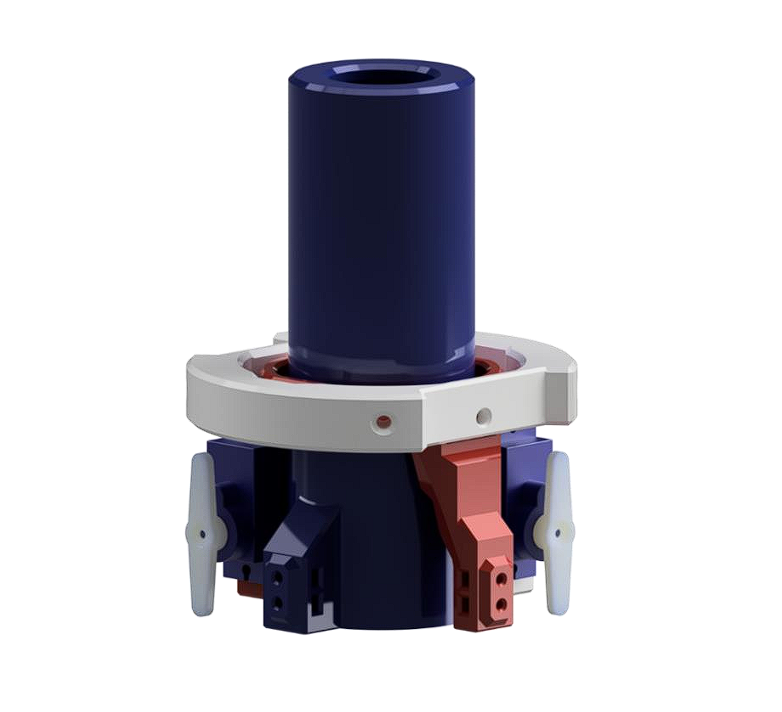
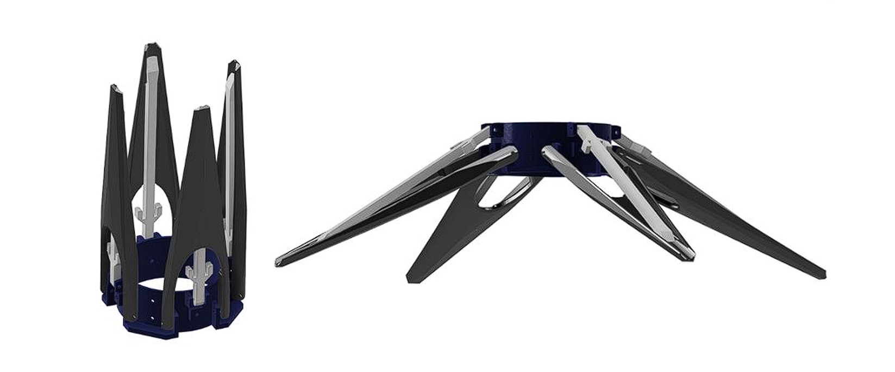
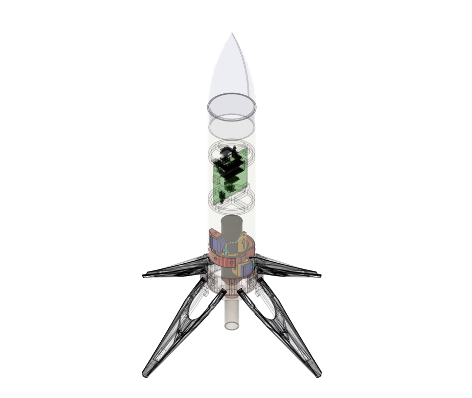
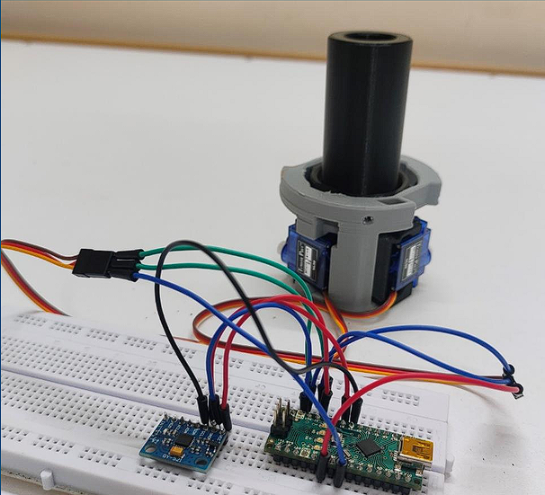
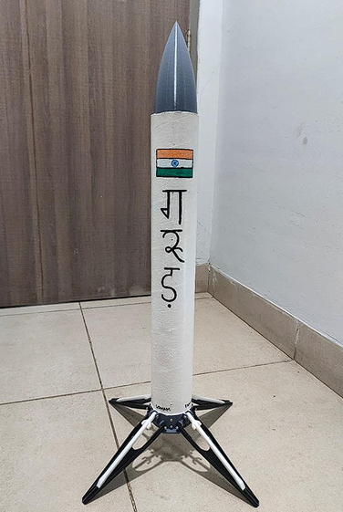

# Project GARUD: Thrust-Vector-Controlled Model Rocket

**Project Objective:**  
Design, analysis, fabrication, and testing of a thrust-vector-controlled (TVC) model rocket.

GARUD was a four-member multidisciplinary engineering project spanning simulation, mechanical design, control-system development, fabrication, and physical integration. **I served as the team leader, coordinating work across these areas to bring the different subsystems together into a unified rocket prototype.**

---

## Project Overview

The project was an end-to-end engineering exercise in developing a thrust-vector-controlled model rocket. Rather than treating trajectory analysis, mechanical design, control, and fabrication as separate tasks, GARUD required them to function as parts of a single physical system.

As team leader, I coordinated collaboration across the mechanical design, avionics, and control aspects of the project while contributing to the design and development of key mechanical subsystems.

The engineering workflow broadly followed:

**Concept → Simulation → Control → Design → Fabrication → Integration → Testing**

---

## Design and Hardware

### TVC Mount Design

The CAD model shows the thrust-vector-control (TVC) mount and its mechanical components, forming the basis for the rocket's thrust-vectoring assembly.

### Deployable Landing-Leg Mechanism

The landing-leg assembly was designed to provide a compact configuration and deployable support for the rocket. The model shows the mechanism in its folded and deployed configurations.

### Full Rocket CAD Assembly

The transparent CAD assembly provides an overview of the rocket's internal arrangement, including the electronics, TVC assembly, and landing-leg mechanism.

### TVC Hardware and Control Electronics

The assembled TVC mount, servos, and control electronics show the transition from mechanical design to hardware integration.

### Physical Prototype

The assembled GARUD rocket demonstrates the integration of the mechanical structure, TVC assembly, and landing-leg mechanism into a physical prototype.

---

## My Contributions

As team leader, my contributions included:

- **Team Leadership:** Coordinated multidisciplinary work across mechanical design, avionics, simulation, and hardware integration to keep the project moving towards a common system-level objective.
- **Mechanical Design:** Developed CAD models of the TVC mechanism and deployable landing-leg assembly.
- **Control & Simulation:** Contributed to flight-physics simulation and thrust-vector-control logic.
- **Fabrication:** Contributed to 3D printing and the physical development of mechanical components.
- **System Integration:** Worked across subsystems to translate digital designs into physical hardware.

---

## Technical Areas

- Systems Engineering
- Mechanical Design and CAD
- Thrust Vector Control
- Flight and Trajectory Simulation
- PID Control
- Physical Prototyping and Additive Manufacturing
- Cross-Functional Team Leadership

---

## Tools Used

**Design & CAD:** Fusion 360, SOLIDWORKS  
**Simulation & Control:** Python, MATLAB/Simulink, RockSim  
**Fabrication:** FDM 3D Printing

---

## Key Takeaway

GARUD demonstrated the difference between designing individual components and bringing them together into a functioning engineering system. As team leader, I experienced the importance of coordinating across disciplines while accounting for manufacturing constraints, assembly, hardware integration, and the practical challenges of physical engineering.

The project remains one of my most important engineering experiences because it brought together technical ownership, multidisciplinary collaboration, and the transition from concept to physical prototype.
